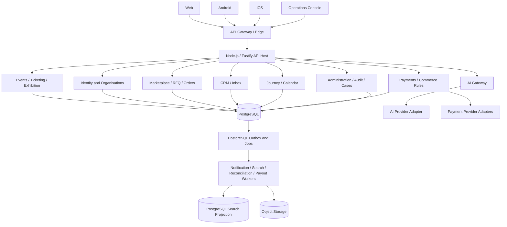
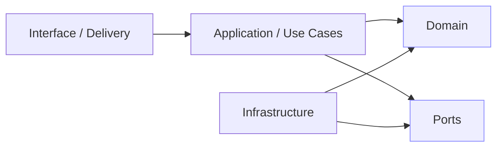
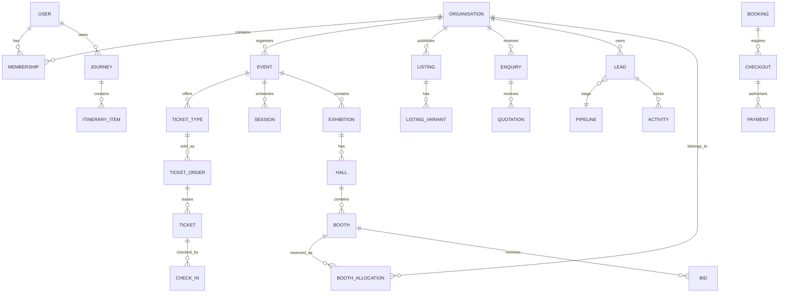

# Architecture and Domain Design

## 1. Logical architecture



## 2. Module and dependency rules



Keep one TypeScript backend package with separate API and worker entry points. Group code by bounded context:

```text
src/
  api.ts
  worker.ts
  modules/<context>/
    index.ts
    domain/
    application/
    infrastructure/
    api/
tests/<context>/
```

- Domain code has no framework, database or HTTP dependencies.
- Application use cases orchestrate domain behavior, authorization and transaction boundaries.
- Infrastructure implements ports for PostgreSQL, providers and durable jobs.
- Cross-context modules communicate through ports or versioned integration events, never ORM entities or raw SQL from another context.
- Each context exports its application interface from `index.ts`. Fastify plugins register routes in the API host. The worker entry point wires jobs to the same application use cases. An import-boundary check enforces the module interfaces and keeps framework and database imports out of domain code.

## 3. Bounded contexts

| Context | Owns | Consumes |
|---|---|---|
| Identity and Organisations | Users, profiles, memberships, roles, permissions, invitations, consent preferences | Notification, audit |
| Event and Schedule | Event, venue, session, event lifecycle, agenda, visibility | Identity, localisation, audit |
| Registration and Ticketing | Ticket type, holds, registration, ticket credential, check-in | Event, payment, notification, identity |
| Exhibition and Inventory | Exhibition, halls, booths, floor plan, booth application, auction, sponsorship | Event, identity, payment, CRM, audit |
| Marketplace | Seller, listing, inventory, catalogue, RFQ, product/service/experience orders | Identity, event, payment, CRM, search |
| CRM and Communication | Contacts, leads, pipeline, activities, consent, conversation timeline | Identity, event/exhibition/marketplace, notification |
| Journey | Itinerary, item, sharing, participant, schedule warnings | Event, booking, marketplace, calendar |
| Commerce and Finance | Checkout, payment, refund, commission, invoice, payout, reconciliation | Inventory contexts, commercial rules |
| Commercial Rules | Commission, fee, subscription and effective-dated rule snapshots | Finance, identity |
| AI and Discovery | Conversations, recommendations, tools, confirmation, AI audit | Search, permissions, read APIs |
| Governance and Operations | Moderation, support cases, disputes, reports, platform configuration | All contexts, audit |
| Platform and Audit | Audit stream, retention, feature flags, taxonomy, data export/deletion | All contexts |

## 4. Core domain model



## 5. Aggregate boundaries

### Identity

- **Organisation** is the root for memberships and organisation-owned resources.
- Invariant: only active members with required permissions can act.
- Membership changes are audited and authorization is re-evaluated per request.

### Event

- **Event** is the root for event lifecycle, visibility and schedule configuration.
- Invariant: published events cannot enter invalid lifecycle transitions.
- Session and media changes are part of Event if schedule consistency must be atomic; high-volume operations are separate aggregates.

### Ticketing

- **TicketOrder** is the aggregate for the buyer's committed purchase and attendee details.
- **TicketTypeInventory** owns sellable quantity, holds and sold totals.
- Invariant: `held + sold <= capacity`, where capacity is the effective sellable count.
- Ticket credential issuance is an application consequence after payment is authoritative.

### Exhibition

- **BoothAllocation** is the aggregate for direct, application and auction award state.
- **Auction** owns bid window, eligibility, reserve, increment and winner result.
- Invariant: exactly one active allocation can confirm a booth for an event.
- Bid history is append-only. Accepted bids are not edited or deleted.

### Marketplace

- **Listing** owns listing status and immutable published configuration.
- **Enquiry** owns enquiry lifecycle and participant-visible content.
- **Quote** owns quote terms and accepted/rejected state.
- Order and fulfilment state remain separate where independent updates need not share a transaction.

### Commerce

- **Checkout** owns pricing snapshot and idempotency.
- **Payment** owns provider transaction state and reconciliation.
- **Refund** owns approved and provider-reported refund amounts.
- Payout is a ledger/batch aggregate, not an aggregate around all seller transactions.

### CRM

- **Lead** is the organisation-owned root for stage and assigned owner.
- Consent is an independent append-only evidence record.
- Sensitive exports and lead sharing create audited operations.

### Journey

- **Journey** owns item lifecycle and sharing.
- Itinerary items reference external offerings only through stable IDs and typed item kind; they do not own booking data.

## 6. Transaction boundaries

| Operation | Transaction boundary | Concurrency control |
|---|---|---|
| Ticket hold | Ticket inventory + hold + outbox | Conditional update or PostgreSQL row lock |
| Ticket confirmation | Verified capture applied to inventory, order, payment, credential records and outbox | Shared transaction with deterministic locks |
| Booth direct purchase | Allocation + hold/application + checkout | Lock/conditional allocation update |
| Booth auction close | Auction + allocation + winner + outbox | One atomic close transaction using server time |
| Booth application approval | Application + allocation state | Row lock and permitted transition |
| Payment webhook | Durable provider inbox first. Worker commits the observed payment and booking outcome. | Unique provider account/event and business effect keys |
| Refund | Refund + payment ledger + booking state | Unique refund key and reason |
| Payout batch | Batch + eligible payout ledger entries | Advisory or row locking per batch/settlement |
| CRM lead update | Lead + activity/audit | Optimistic version or row lock |

Cross-context consequences use integration events rather than distributed transactions. If a consequence is required for the same user outcome, verify and report partial progress explicitly.

## 7. Domain events

Examples:

- `EventPublished`, `EventCancelled`
- `TicketHeld`, `TicketHoldExpired`, `TicketOrderConfirmed`
- `CheckInRecorded`, `DuplicateCheckInAttempted`
- `BoothApplicationSubmitted`, `BoothApproved`, `BoothBooked`
- `AuctionClosed`, `AuctionWinnerDefaulted`
- `PaymentAuthorised`, `PaymentFailed`, `RefundCompleted`
- `PayoutBatchScheduled`, `PayoutSubmitted`, `PayoutReconciled`
- `LeadCaptured`, `ConsentRecorded`
- `ItineraryItemChanged`
- `AIActionConfirmed`

Use past tense, schema version, producer, tenant/organisation, resource, correlation ID and occurred-at UTC. Internal domain events may carry richer data; integration events carry only the versioned contract.

## 8. Extraction boundaries

Extract to an independent process only when one of these is measured:

- A worker needs independent scaling or isolation.
- A module has a separate change/deployment cadence.
- A provider or workload creates unacceptable noisy-neighbor risk.
- Legal or residency boundaries require physical separation.

First extraction candidates are notification delivery, search indexing, AI orchestration and reconciliation. These are already behind application ports and can become workers.
