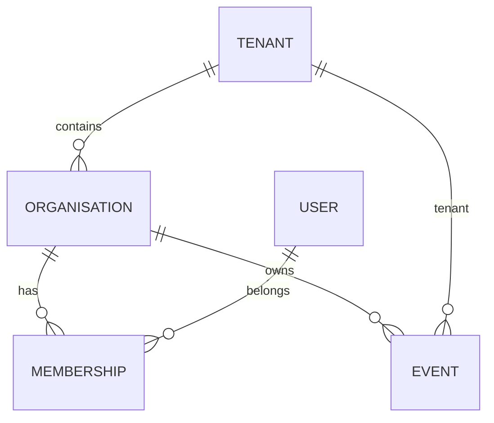
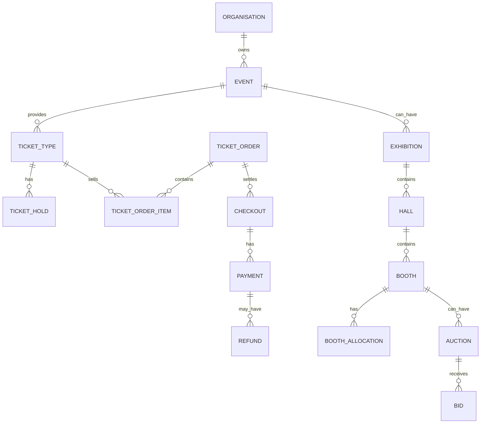

# Database and Persistence Design

## 1. Technology

PostgreSQL is the recommended system of record:

- Strong constraints and transactions
- JSONB only for explicit extension data, not core domain relationships
- Row-level locking and advisory locks
- Partial indexes for state-based queries
- Native UUID support
- Point-in-time recovery and read replicas

Use Kysely with `pg` in infrastructure adapters. For atomic booking operations, pass the same transaction-scoped connection to the participating adapters, including the outbox writer. Use conditional updates, parameterized SQL and PostgreSQL constraints for inventory invariants. Perform network calls to payment providers outside database transactions and apply their results through the booking and payment use cases.

Do not use MongoDB or DynamoDB as an additional source of truth for MVP booking or financial state.

## 2. Tenancy

Use **shared database with tenant-aware rows** for MVP:

- `tenant_id` on tenant-owned tables
- `organisation_id` on organisation-owned resources
- `user_id` on personal resources
- Composite indexes that begin with tenant/organisation where applicable
- Application-level row filtering plus database roles for privileged jobs

Use `tenant_id` consistently as the platform/customer boundary. For the pilot, provision one tenant per organisation. A deployment-wide principal acts through memberships and explicit transaction participation. See [launch access rules](./09-eventos-launch-contracts.md#identity-and-participant-access).

PostgreSQL Row Level Security is an optional defense-in-depth control after application authorization is proven. RLS should not replace use-case-level authorization.



Physical tenant separation is deferred until residency, contract or isolation requirements justify it. A country/region partition strategy must be decided before shipping regulated data.

## 3. Core schema

### Identity

```sql
tenants(id, name, status, region_code, default_locale, default_currency, created_at)
users(id, oidc_issuer, oidc_subject, status, email, phone, primary_locale, created_at)
organisations(id, tenant_id, owner_user_id, type, verification_status, created_at)
memberships(id, tenant_id, organisation_id, user_id, status, invited_at, accepted_at)
roles(id, tenant_id, organisation_id, name, system_role)
permissions(id, tenant_id, code)
role_permissions(role_id, permission_id)
membership_roles(membership_id, role_id)
consent_records(id, tenant_id, subject_type, subject_id, purpose, channel, action, evidence, recorded_at)
```

Indexes:

- `users(oidc_issuer, oidc_subject)` unique
- `organisations(tenant_id, status)`
- `memberships(tenant_id, organisation_id, user_id)` unique
- `role_permissions(role_id, permission_id)` unique
- `consent_records(subject_type, subject_id, purpose, recorded_at)`

### Event and ticketing

```sql
events(id, tenant_id, organisation_id, slug, type, status, visibility, format,
       starts_at, ends_at, local_timezone, capacity, current_version, created_at)
event_localizations(event_id, locale, name, short_description, long_description)
venues(id, tenant_id, organisation_id, address_json, geo, timezone)
sessions(id, tenant_id, event_id, name, starts_at, ends_at, room, status)
ticket_types(id, tenant_id, event_id, name, category, currency, unit_amount_minor,
             quantity, held_quantity, sold_quantity, sales_starts_at, sales_ends_at,
             eligibility_json, state, version)
ticket_orders(id, tenant_id, event_id, buyer_user_id, status, currency,
              subtotal_minor, fee_minor, tax_minor, total_minor, price_snapshot_json,
              idempotency_key, version, created_at)
ticket_order_items(id, tenant_id, order_id, ticket_type_id, quantity, unit_snapshot_minor)
tickets(id, tenant_id, order_id, ticket_type_id, credential_hash, status, issued_at)
check_ins(id, tenant_id, ticket_id, operator_user_id, checked_in_at, override_reason)
ticket_holds(id, tenant_id, ticket_type_id, order_id, quantity, expires_at, status)
```

Unique constraints:

- `(tenant_id, event_id, slug)`
- `(tenant_id, idempotency_key)`
- `(tenant_id, ticket_credential_hash)`
- `(ticket_id, successful_check_in_id)` where applicable

Indexes:

- events `(tenant_id, organisation_id, status, starts_at)`
- public events `(starts_at, status, visibility)` partial where status published
- ticket types `(event_id, state)`
- holds `(expires_at, status)`
- tickets `(tenant_id, order_id)`
- check-ins `(ticket_id, checked_in_at)`

Prevent duplicate successful check-in with a partial unique index or explicit service status plus row lock.

### Exhibition

```sql
exhibitions(id, tenant_id, event_id, floor_plan_storage_key, sale_policy, status)
halls(id, tenant_id, exhibition_id, name, layout_json)
booths(id, tenant_id, hall_id, booth_number, geometry_json, type, visibility,
       currency, price_minor, status, sale_mode, version)
booth_allocations(id, tenant_id, booth_id, organisation_id, application_id,
                  status, held_until, version)
booth_applications(id, tenant_id, exhibition_id, organisation_id, status,
                   submitted_json, documents_json, reviewed_by, review_reason)
auctions(id, tenant_id, booth_id, status, currency, starting_bid_minor,
         reserve_price_minor, increment_rules_json, opens_at, closes_at, tie_break_rule,
         payment_deadline_at, winner_organisation_id, version)
bids(id, tenant_id, auction_id, organisation_id, amount_minor, status,
     idempotency_key, submitted_at)
sponsorships(id, tenant_id, event_id, package_json, price_minor, currency, status)
```

Constraints:

- One active allocation per booth through a partial unique index on `booth_id` where `status in (Held, AwaitingPayment, Confirmed, Blocked)`.
- Unique accepted bid per auction tie-break implementation, if applicable.
- Append-only bids: no update/delete API.
- Auction close uses one transaction and server timestamp.

### Finance

```sql
checkouts(id, tenant_id, buyer_id, seller_id, seller_of_record, booking_type,
          booking_id, currency, total_minor, price_snapshot_json, status, idempotency_key)
payment_intents(id, tenant_id, checkout_id, provider, provider_reference,
                status, charge_currency, charge_amount_minor, raw_provider_ref removed)
payment_events(id, tenant_id, provider, provider_account_ref, provider_event_id, payload_hash,
               received_at, processed_at)
refunds(id, tenant_id, payment_id, status, amount_minor, reason, approved_by,
        provider_ref, idempotency_key)
ledger_entries(id, tenant_id, account_id, debit_minor, credit_minor, currency,
               transaction_id, entry_type, recorded_at)
payout_batches(id, tenant_id, cut_off_at, timezone, status, scheduled_at)
payout_items(id, tenant_id, payout_batch_id, seller_id, amount_minor, status,
             provider_ref, failure_reason)
commercial_rule_versions(id, tenant_id, version, rule_json, effective_from,
                        effective_to, priority, status)
```

Require a unique provider/account/event key and keep the normalized observation or protected replay reference needed to apply it. A unique business operation key on each balanced journal prevents distinct delivery events for the same capture from posting twice. See the [finance and recovery contract](./09-eventos-launch-contracts.md#finance-and-recovery). Never store raw card details or sensitive gateway secrets in application data.

## 4. Entity relationship overview



## 5. Money and snapshots

The framework-free `src/shared/values/money.ts` implements signed minor-unit arithmetic, explicit JSON number conversion and PostgreSQL `bigint` text conversion. Commerce validates launch-market and provider eligibility when accepting a checkout. The Event slice can use the other shared values to normalize content locales, select a source translation fallback and validate offset-qualified event time against its IANA zone before storing the UTC instant.

- Store `{amountMinor, currency}` on every transaction item.
- Convert PostgreSQL `bigint` amounts explicitly at the adapter boundary. Use TypeScript `bigint` for exact integer calculations. Validate public JSON number amounts against the safe-integer range and provider-specific limits before committing a checkout. Validate again when serializing to adapters that require numbers.
- Store accepted price, tax, fee, discount and terms snapshots in checkout/order records.
- Recompute from server-side rules, but never overwrite the immutable committed snapshot.
- Currency conversion is provider/market-service derived and includes rate source and timestamp.
- Display conversion must never change the charge currency.
- Financial adjustments require an actor, reason and target ledger entry.

## 6. Concurrency patterns

Use an order of operations for inventory:

1. Validate state and sales window.
2. Recompute server-side price.
3. Lock inventory allocation or update with a version/quantity condition.
4. Create hold and outbox message in one transaction.
5. Return hold expiration.
6. Checkout verifies hold before provider action.
7. Provider webhook confirms payment and transitions state atomically.

Use PostgreSQL as the sole authority for inventory locks and reservations.

## 7. Caching

Cache:

- Public event/listing projections
- Organisation permission sets
- Commercial rule effective views
- Taxonomy and public configuration
- Search suggestions

Do not cache:

- Payment status
- Ticket/booth availability totals
- Auction close result
- Lead permission decisions
- Payout eligibility

TTL default: 30-300 seconds for public projections; invalidate on integration events. Permission caches must invalidate immediately and be key-scoped by membership/version.

## 8. Search and indexing

PostgreSQL remains source of truth. Maintain search projections in PostgreSQL using full-text indexes and trigram matching:

- Event/listing/booth/provider document IDs
- Tenant/organisation/status/locales
- Geolocation, dates, category, price, verification and availability
- Text in separate localized fields
- Sponsored rank separated from organic ranking

Rebuild indexes through a replayable projector. Search lag must be visible, and an API must not claim authoritative availability solely from search.

## 9. Data lifecycle

| Class | Examples | Rule |
|---|---|---|
| Public | Event/listing | Long-lived, soft delete, explicit public archive |
| Operational | Orders, holds, leads | Retain per tenant policy and legal minimum |
| Personal | Profile, attendee details | Export/delete workflows, minimization and field-level access |
| Sensitive | Documents, identity evidence | Private object storage, short links, malware scan, encryption |
| Financial | Ledger, tax, refunds, payouts | Immutable and retained under jurisdiction/law |
| Audit | Permission, finance, AI actions | Append-only, tamper-evident export, retention |
| Consent | Purpose/channel evidence | Append-only, no silent update/deletion |

Deletion must be jurisdiction-aware and may mean anonymization for financial/audit references rather than physical removal.

## 10. Migrations and backups

- Commit ordered Kysely migrations and ship their compiled artifacts with the release. Run them in one deployment job before application rollout. Test both a fresh install and upgrades from the previous release against real PostgreSQL.
- Expand/migrate/contract for schema changes.
- Use forward-compatible application releases for event and API contract changes.
- Index creation must use low-impact operations/partitions where the table is large.
- Pre-run migration checks for lock duration and table bloat.
- Backups: encrypted, cross-zone; RPO 15 minutes/PITR target.
- Quarterly restore tests in an isolated environment.
