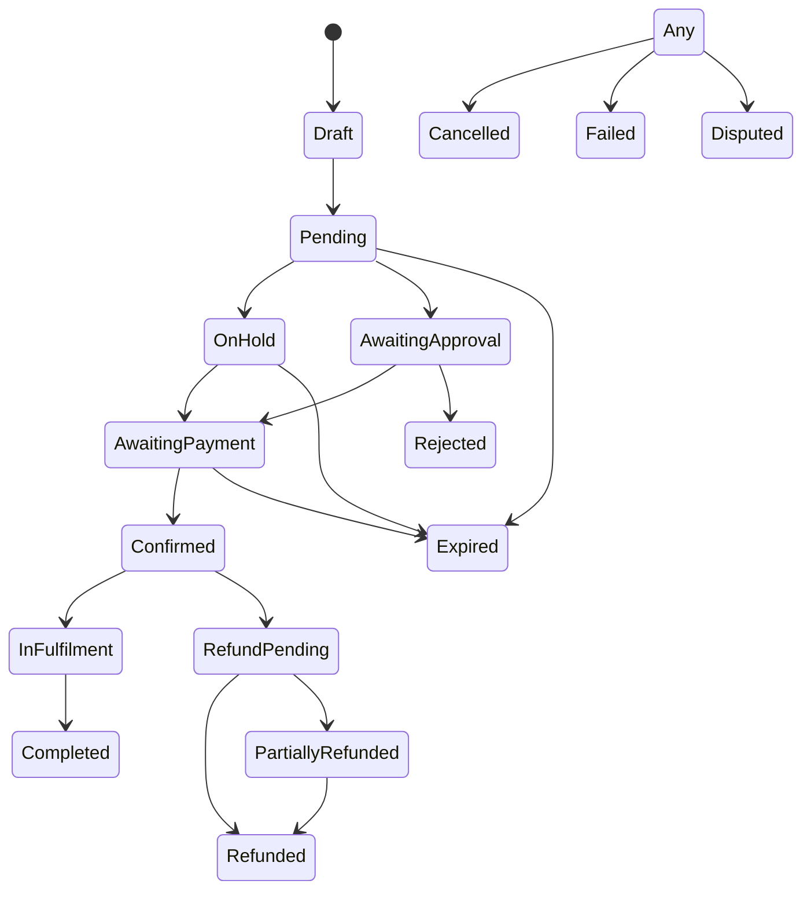
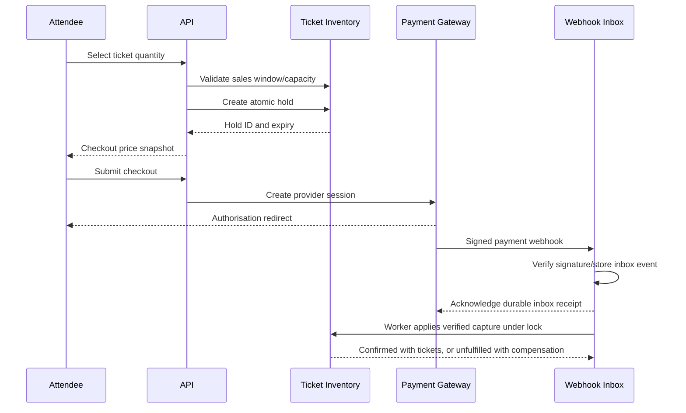
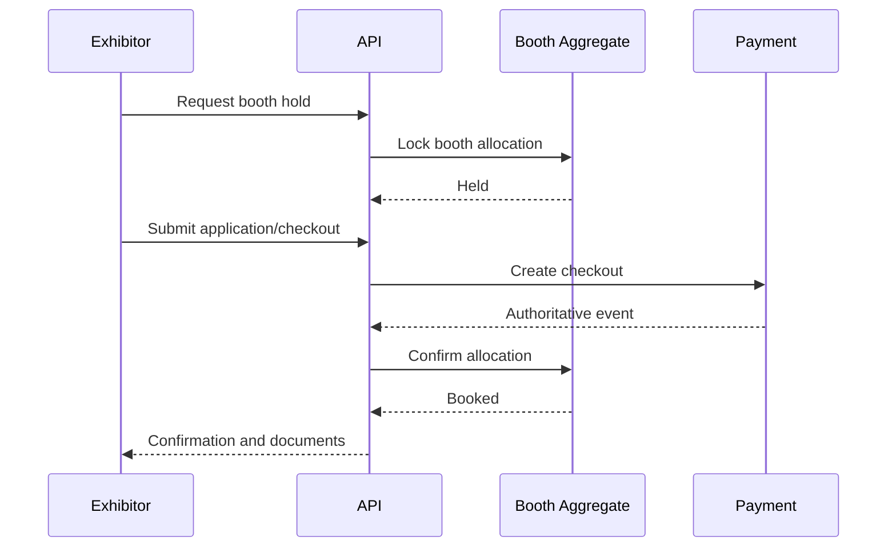
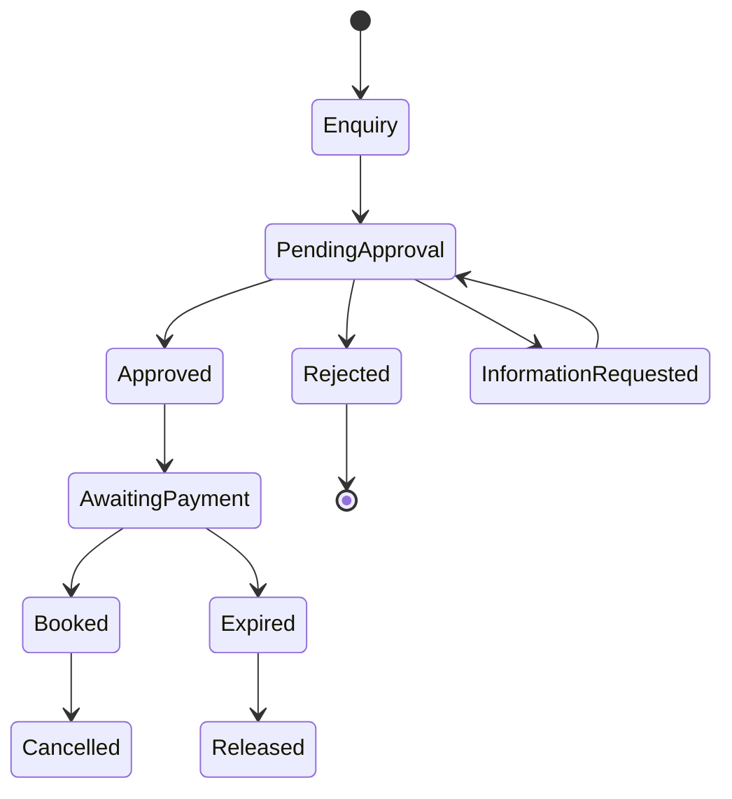
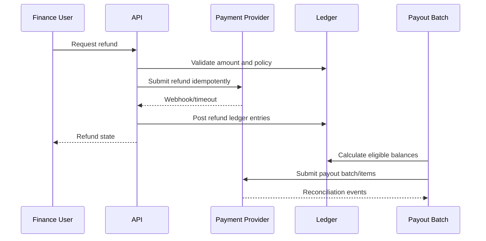
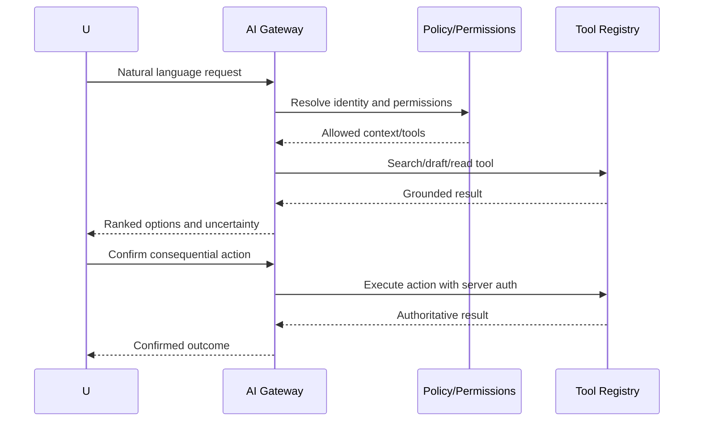

# Workflows, State Machines and Event Processing

## 1. General booking state



Only each inventory type's domain state machine may define legal transitions. Generic states are not a substitute for booking-specific rules.

## 2. Ticket purchase



Rules:

- Hold expiration is server-driven. See the [launch cutoff and compensation rules](./09-eventos-launch-contracts.md#payment-and-inventory).
- Browser redirect never confirms payment.
- Provider event signature, provider event ID and idempotency key are mandatory.
- Unknown provider state performs reconciliation, not optimistic confirmation.
- Retry must not issue duplicate tickets or charge twice.

## 3. Booth direct purchase



Direct purchase and auction close share the same allocation invariant.

## 4. Booth application



Approval does not reserve capacity indefinitely. The approved deadline and hold expiry are explicit.

## 5. Auction close

1. Scheduler acquires close job using server time and event/auction ID.
2. Close transaction loads auction and active allocation.
3. It verifies close time and auction status.
4. It computes winner using published reserve and accepted bid order.
5. It creates or updates the allocation and winner payment deadline under the shared booth lock. See the [launch auction contract](./09-eventos-launch-contracts.md#booth-auction-and-hybrid).
6. It writes integration event and audit record in the outbox.
7. Payment-confirmed winner becomes booked.
8. Missed deadline invokes fallback/winner-default workflow.

No bid is accepted after close time, regardless of network timestamp. `Bids` are append-only.

## 6. Event cancellation

1. Organiser submits cancellation reason and effective policy.
2. Application checks permission and creates a cancellation operation.
3. Event state becomes Cancelled.
4. Inventory stops selling and existing holds release.
5. Refund eligibility is calculated per type/policy and tax/fee rules.
6. Refunds enter approval or automatic-processing path where configured.
7. Ticket/effected booking notifications are queued.
8. Audit and reconciliation records are persisted.
9. Operators resolve exceptions in the support case module.

## 7. Refund and payout



Refund state and booking state are separate. Payout excludes disputes, risk holds and unsettled/refunded amounts.

## 8. CRM lead capture

QR lead capture:

1. Verify visitor consent notice and explicit action.
2. Resolve or create organisation-owned lead.
3. Attach source event/booth and consent evidence.
4. Restrict exports and notes to authorised organisation users.
5. Emit lead-created event for inbox/analytics only if permitted.
6. Audit scan and capture.

A registration does not automatically share all attendee data with exhibitors.

## 9. AI orchestration



Allowed AI tools are read or draft only unless confirmation is explicit. The server re-authorizes every tool action. Payment and booking tools always use the normal application use cases.

## 10. Notifications

Categories:

- `transactional.booking`
- `transactional.payment`
- `transactional.event_update`
- `operational.support`
- `marketing.approved`

Notification payload:

- Template key and locale
- Organisation branding
- Tenant
- Channel
- Recipient
- Consent status
- Correlation ID
- Delivery deadline

Critical booking/payment notifications use durable outbox delivery, exponential backoff and a dead-letter handling. Marketing remains opt-in and rate-limited.

## 11. Asynchronous infrastructure

Use transactional outbox:

```sql
outbox(id, tenant_id, aggregate_type, aggregate_id, event_type,
       schema_version, payload, status, available_at, attempts,
       last_error, created_at)
```

Consumers maintain inbox records:

```sql
inbox(id, consumer, event_id, processed_at)
```

Rules:

- Outbox insert is in the business transaction.
- A bounded worker claim creates a time-limited lease on a delivery record per consumer. Mark delivery complete only after its effect is durable. Use attempt ownership when completing a lease and retain enough history for replay.
- Inbox unique key prevents duplicate processing.
- Consumers are idempotent.
- Retry deadlines, exponential backoff and dead-letter replay are mandatory.
- Replay never invents successful payment or booking state.
