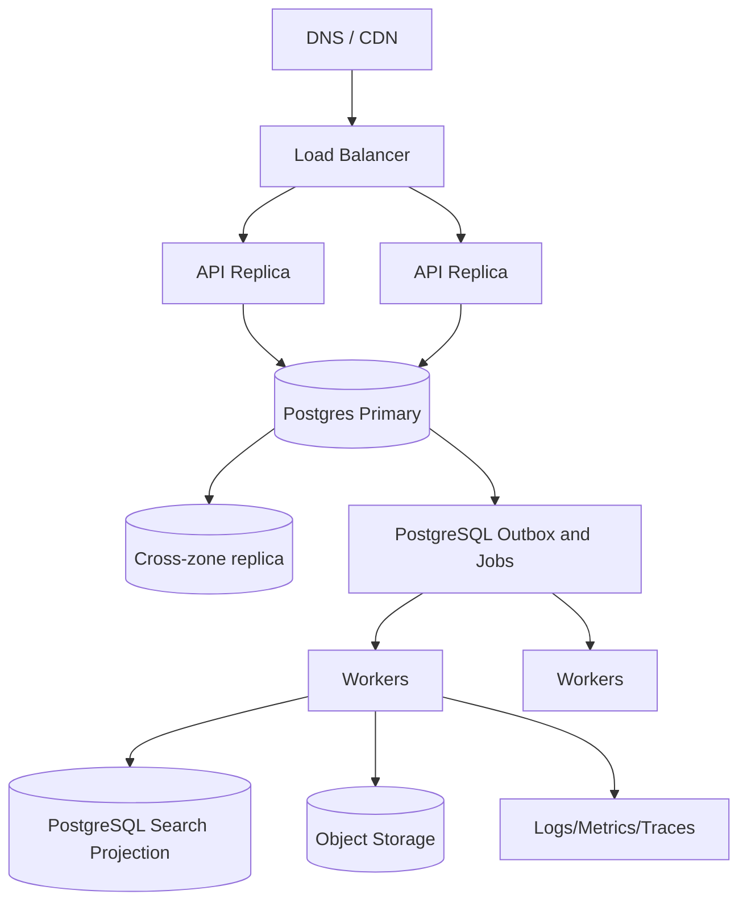

# Integrations and Infrastructure

## 1. Integration architecture

Every external provider is behind a narrow port:

```text
Domain/use case
  -> provider-independent interface
  -> provider adapter
  -> provider SDK/API
```

Adapter rules:

- Verify provider signatures
- Normalize provider state
- Persist provider event
- Enforce idempotency
- Map provider errors to domain outcomes
- Apply timeouts and bounded retry
- Never leak provider SDK types into domain code

## 2. Payment adapter

Recommended initial provider: Razorpay, subject to eligible country, account type, Route eligibility and settlement model.

Interface:

```text
CreateCheckout
CreateProviderSession
GetTransactionState
SubmitRefund
GetRefundState
SubmitPayoutBatchItem
VerifyWebhook
GetSettlementRecords
```

Use provider-independent enums for:

- `Pending`
- `Authorized`
- `Captured`
- `Failed`
- `RefundPending`
- `Refunded`
- `Reversed`
- `Unknown`

Never map a browser redirect to successful charge. Webhooks and reconciliation determine authoritative state.

### Commercial model

Start with organiser/seller as MoR. Legal and tax advisers must confirm per country and vertical. The platform stores seller of record and invoice contract with every checkout.

### Payout batch

At configured cut-off:

1. Calculate eligible seller balances.
2. Deduct commission, tax and configured fees.
3. Exclude unsettled, disputed or held funds.
4. Produce payout batch snapshot.
5. Submit item with idempotency key.
6. Reconcile provider state and settlement webhooks.
7. Expose Scheduled/Processing/Paid/Failed/OnHold/Reversed.

Daily payout is a preference, not a guarantee of same-day bank credit.

## 3. Notification adapters

Implement adapters for email, SMS, WhatsApp, push and in-app inbox.

- Channel template registry
- Locale fallback
- Organisation branding
- Consent and opt-out lookup
- Provider message reference
- Provider status mapping
- Time-window and template policy
- Rate limiting

WhatsApp/Instagram require official APIs and approved account onboarding. The CRM stores provider message references and consent; it does not scrape unofficial channels.

## 4. Maps and calendar

Map adapter:

- Geocode
- Search
- Reverse geocode
- Directions/travel-time estimate

Cache provider responses only as allowed and include provider terms/TTL.

Calendar adapter:

- Generate ICS without OAuth for MVP
- Optional Google Calendar integration
- Microsoft Graph in later phases
- Narrow OAuth scopes
- Explicit user choice to add/share

## 5. AI gateway

Recommended initial model: Gemini behind a provider-independent AI gateway.

Capabilities:

- Prompt version
- Model/version selection
- Tenant/user context filtering
- Tool allowlist
- Output schema validation
- Confirmation token
- Prompt-injection checks
- Audit event
- Provider fallback
- Cost/rate controls

Do not send card details, identity documents or unnecessary CRM/attendee data to the model.

## 6. File storage

- Private buckets for identity documents and sensitive exports
- Public or CDN-backed buckets for approved event media
- Server-generated upload policy
- Content type/size limits
- Malware scanning
- Hash and immutable object reference
- Signed URLs
- Floor-plan geometry in PostgreSQL, files separate

## 7. Infrastructure layout



Use managed services where they reduce operational burden. Managed database failover and PITR are preferred to a manually operated PostgreSQL cluster at MVP scale.

## 8. Deployment

- Immutable container images
- Use a pinned Node.js LTS runtime. Run the compiled TypeScript output with separate API and worker commands and separately sized PostgreSQL connection pools. Budget the sum of replica and worker pool limits against the database connection limit.
- Non-root container execution
- Distroless or minimal approved base
- Supply-chain scan and signed artifact
- Database migration job as a separate deployment step
- Readiness/liveness separated
- Graceful shutdown on `SIGTERM`. Drain HTTP requests and stop claiming jobs before closing database pools. Return unfinished jobs to the normal recovery path.
- Request and provider-call timeouts
- Auto-scaling based on CPU plus queue depth/latency

## 9. CI/CD

Pipeline:

The Foundation slice introduces the npm scripts below. They are planned CI commands for the future application.

1. Install from the committed lockfile with `npm ci`.
2. Run `npm run lint`, `npm run typecheck`, `npm run build` and `npm test` for lint, strict TypeScript checks, JavaScript compilation and unit tests.
3. Static analysis/security scan
4. Container image build and dependency scan
5. Run `npm run test:contract` for Fastify and OpenAPI compatibility checks.
6. Migration drift check
7. Run `npm run test:integration` with disposable PostgreSQL. Include a broker container in jobs that exercise the selected broker adapter.
8. Deploy to staging
9. Smoke/load/security checks
10. Canary to production

Production promotion requires:

- Migration compatibility
- Outbox/consumer readiness
- Provider credentials and secrets
- Feature flags
- Rollback/forward-fix plan

## 10. Configuration

Separate:

- Environment
- Region
- Tenant defaults
- Organisation overrides
- Feature flags
- Provider credentials
- Commercial rules

Provider credentials are in secrets management. Commercial rules are versioned data, not environment variables.

## 11. Backup and recovery

- Automated encrypted backups
- PostgreSQL PITR
- Cross-zone backup copy
- Immutable object storage for critical uploads
- Outbox replay for derived stores
- Search rebuild procedure
- Rebuild optional caches from authoritative data

Follow the [commercial restore and restart procedure](./09-eventos-launch-contracts.md#finance-and-recovery). The quarterly restore drill verifies:

- API startup
- DB snapshot/PITR
- encrypted backup access
- provider webhook replay and reconciliation of charges and transfers that survived the local restore point
- notification/search recovery
- documented RPO/RTO
