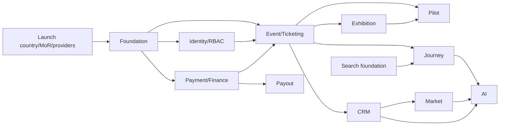

# Testing Strategy and Implementation Roadmap

## 1. Test levels

| Level | Coverage | Examples |
|---|---|---|
| Domain unit | Invariants and state transitions | Over-sell, auction close, refund amount, permission state |
| Application | Use cases and authorization | Hold, confirm payment, approve booth, capture lead |
| Infrastructure integration | Real database/broker/provider contract | PostgreSQL locks, outbox/inbox, webhook signature |
| API/contract | REST compatibility and validation | Idempotency, 401/403/404, pagination, schema |
| E2E | Critical user journeys | Publish event, buy ticket, check in, book booth |
| Security | Tenant and privilege boundaries | Cross-tenant IDOR, export, privilege escalation |
| Concurrency | Race and retry | Same booth/ticket, duplicate webhook, duplicate bid |
| Resilience | Provider and worker failure | Timeout, replay, dead-letter, partial fulfillment |
| Performance | Burst and peak behavior | Ticket launch, auction close, check-in, search |
| Accessibility | WCAG 2.2 AA user journeys | Keyboard, labels, contrast, focus, screen reader |

## 2. Critical test matrix

| Scenario | Required evidence |
|---|---|
| Two exhibitors hold the same booth | Exactly one hold succeeds |
| Direct purchase and auction close race | Exactly one valid allocation result |
| Auction bid after close | Rejected by server time |
| Duplicate payment webhook | One booking/payment outcome |
| Provider timeout | Unknown state reconciled, not false success |
| Browser closes after provider charge | Webhook confirms and ticket is issued |
| Event cancellation | Refund, inventory and notifications follow policy |
| Payment unknown then refund | Ledger and booking remain consistent |
| Staff loses permission | Active request re-evaluates authorization |
| Cross-organisation lead access | 404/403 and audit record |
| AI proposes booking | No side effect until confirmation |
| AI model outage | Core workflow remains available |
| Queue replay | Inbox prevents duplicate side effects |
| Seller price changes after checkout | Checkout snapshot remains committed |
| Payout batch retry | Provider and ledger not double-paid |

## 3. Test environments

- Vitest unit tests run locally and in CI without external services. Use Fastify's `inject()` for HTTP contract tests and check generated OpenAPI for breaking changes.
- Use an isolated PostgreSQL service in CI and a disposable database locally. Add a disposable broker only if a broker adapter is introduced. Verify real migration SQL, separate connections for racing transactions, and webhook signature verification on the original request bytes.
- Payment tests use sandbox/provider contract fixtures.
- Security tests use dedicated tenant/organisation fixtures.
- Performance tests use production-like hardware and representative data.
- DR test uses isolated environment and encrypted test backups.

## 4. Load assumptions

Planning baseline:

- 10,000 requests/day
- 20 requests/second sustained burst
- 50 requests/second pre-launch
- 100 requests/second horizontal scaling target

Separate tests:

- Ticket release
- Booth hold/checkout
- Auction close
- Payment webhooks
- QR check-in
- Search
- Notification fan-out

Capture p50/p95/p99 latency, error rate, database locks/connections and queue lag.

## 5. Implementation phases

### Foundation

Deliverables:

- Node.js 24 LTS and strict TypeScript, with Fastify API and worker entry points in one npm package. Pin the toolchain, commit the lockfile and enforce module boundaries in CI.
- Kysely and `pg` baseline with versioned migrations, plus one schema-backed API and worker path that prove the stack works together.
- Identity/OIDC and organisation membership
- RBAC and policy evaluator
- PostgreSQL schema/migrations
- Audit/outbox/inbox infrastructure includes the [Razorpay provider inbox](../implementation-plans/2026-11-21-foundation-provider-inbox.md). Payment reconciliation and additional internal consumers remain separate.
- Localisation/currency/money primitives delivered in the [Foundation money and localization slice](../implementation-plans/2026-11-20-foundation-money-localization.md). Configurable, versioned commercial rules remain a separate Foundation deliverable.
- [PostgreSQL outbox leasing](../implementation-plans/2026-11-20-foundation-durable-jobs.md) and an [internal public search projection](../implementation-plans/2026-11-20-foundation-search.md). [Public search API and Discovery consumer inbox](../implementation-plans/2026-11-21-foundation-discovery-consumer.md) are implemented. [Event publisher wiring](../implementation-plans/2026-11-21-foundation-event-publishing.md) is implemented. Marketplace publishing remains pending.
- [Fixed-fee commercial preview](../implementation-plans/2026-11-20-foundation-commercial-preview.md). [Persistent fixed-fee authoring and audited approval](../implementation-plans/2026-11-21-foundation-commercial-authoring.md) use a private operator command. Market scope, platform admin integration and checkout wiring remain future work.
- Observability and CI/CD

Exit:

- Tenant isolation suite passes
- Audit and migration pipeline proves repeatable
- P0 APIs meet security and contract tests
- Planned npm CI checks pass and a fresh database plus an upgrade from the previous schema revision both work.

### Release 1: EventOS

Deliverables:

- Event lifecycle
- Ticket types and inventory holds
- Free/paid checkout
- Razorpay adapter and webhook reconciliation
- QR ticket issuance
- Check-in and duplicate protection
- Exhibition/floor plan/booth direct purchase/application
- Auction close and winner payment
- Basic sponsorship and a scope decision on consented exhibitor lead capture
- Organiser/exhibitor dashboards
- Refund and cancellation workflows, invoices and receipts, and an approved settlement path. Automated payout is an explicit pilot scope decision.

Exit:

- MVP acceptance checklist passes
- Concurrency and payment replay tests pass
- Controlled pilot rollback and support runbooks are ready

### Release 2: MarketOS and CRM

Deliverables:

- Generic listing foundation
- Event services first
- RFQ/quotation
- Lead, pipeline and activity
- Consent and communication timeline
- WhatsApp/Instagram official adapter when approved
- Reviews and verification

Exit:

- Private lead isolation and export authorization pass
- Inquiry/quote/audit workflows operate end-to-end

### Release 3: Exhibitor product catalogue and RFQ

Deliver verified exhibitor catalogue, event association and scoped product RFQ. Gate direct product sales independently.

### Release 4: Experiences and JourneyOS

Deliverables:

- Experiences
- Itinerary
- Maps, calendar, share/reminders
- Confirmed/suggested/saved item distinction
- Schedule overlap detection

### Release 5: IntelligenceOS

Deliverables:

- Gemini provider adapter
- Retrieval/tool allowlists
- AI action confirmation
- AI audit and opt-out
- Sponsored ranking labels

### Later: Enterprise expansion

Deliverables:

- Regional provider adapters
- Advanced analytics
- Enterprise controls and integrations
- Multi-region/residency controls
- Advanced automation

## 6. Dependencies

## 7. Delivery slices

Implement vertical slices:

1. Publish event
2. Register for free event
3. Pay for ticket and issue QR
4. Check in attendee
5. Configure floor plan and booth
6. Hold/confirm booth
7. Submit/approve booth application
8. Close auction and collect winner payment
9. Refund and notify
10. Payout and reconcile

Each slice must include UI contract, API, data, authorization, outbox event, notification and tests.

## 8. Acceptance gates

No pilot release until:

- [ ] Tenant/role isolation tests pass
- [ ] Inventory concurrency tests pass
- [ ] Payment webhook replay/timeout tests pass
- [ ] Audit and refund workflows pass
- [ ] Backup restore and provider reconciliation drill passes, including post-restore-point charges and transfers
- [ ] Hot-event checkout, same-booth contention, QR check-in and worker replay meet validated workload targets
- [ ] Approved payout or settlement path passes reconciliation. Duplicate transfer, refund race and late-capture cases pass
- [ ] PRD v1.1 pilot scope and web/Android/iOS acceptance are signed off, with explicit authorised deferrals
- [ ] Critical accessibility checks pass
- [ ] Incident and support runbooks are approved
- [ ] Legal/privacy/provider constraints are confirmed
